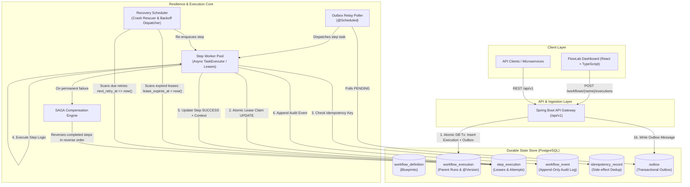

# High-Level Design (HLD): Crash-Proof Workflow Engine (FlowLab)

## 1. Problem Statement & Motivation
In distributed software systems, business processes (such as e-commerce checkout, loan origination, and customer onboarding) span multiple services and take minutes, hours, or days to complete. In a naive microservice architecture, these multi-step flows are prone to critical failure modes:
1. **Mid-Flight Crashes (`kill -9`)**: If a worker node crashes halfway through an order flow (e.g., after charging the card but before updating warehouse inventory), memory is lost. The system either abandons the workflow or restarts from scratch, resulting in double-charging or broken state.
2. **Dual-Write Inconsistency**: Attempting to commit state to a database and simultaneously publish an event to a message broker (e.g., Kafka) risks split-brain failure if one succeeds and the other fails.
3. **Double Execution on Redelivery**: Distributed queues (Kafka/RabbitMQ) guarantee at-least-once delivery; without idempotency controls, duplicate messages trigger duplicate side effects (e.g. charging a credit card twice).
4. **Cascading Failures without Rollback**: If a downstream step fails permanently after upstream steps completed, there is no automatic mechanism to reverse completed side effects.

**FlowLab** is a **Crash-Proof, Resilient Workflow Engine** engineered to solve these problems by adhering to the core principle: **persist state before and after every step transition, making the database the source of truth, not in-memory state.**

---

## 2. Requirements Analysis

### 2.1 Functional Requirements
- **Workflow Blueprints**: Register and version ordered multi-step workflows (e.g., `Order Processing`: `Validate Order` → `Process Payment` → `Update Inventory` → `Send Notification`).
- **Durable Orchestration**: Start workflow executions, persist exact step progress, and return asynchronous status handles (`202 Accepted`).
- **Crash Recovery**: If the host process terminates abruptly (`kill -9`), restarting or running the recovery scheduler resumes execution from the exact step that was pending or failed.
- **Idempotency**: External side-effect steps (like payment gateways) must execute effectively once, even under duplicate event deliveries or retry cycles.
- **Configurable Retry with Exponential Backoff**: Transient failures schedule future retries with jitter stored in the database—never blocking worker threads with `Thread.sleep`.
- **SAGA Compensation**: When a step encounters an unrecoverable failure, the engine automatically rolls back prior completed steps in reverse chronological order.
- **Audit Logging & Telemetry**: Full append-only event stream tracking each step attempt, lease acquisition, duration, and error details.

### 2.2 Non-Functional Requirements
- **Durability**: Zero data loss for accepted workflows. Database transactions guarantee ACID consistency.
- **Stateless Workers**: Workers can be added or terminated dynamically without risking orphaned workflows or corrupted state.
- **High Availability**: Decoupled asynchronous polling and scheduling prevents single points of failure.
- **Scalability**: High throughput support via optimistic locking and indexed status polling.

---

## 3. Capacity Estimates (Assumed Scale)
In a system design interview, establishing clear baseline numbers proves viability:
- **Workload**: 1,000,000 workflow executions per day.
- **Average Throughput**: $\approx 12\text{ workflows/sec}$.
- **Peak Throughput (10x)**: $\approx 120\text{ workflows/sec}$.
- **Step Events**: 4 steps per workflow $\rightarrow \approx 500\text{ step transitions/sec}$ at peak.
- **Storage Footprint**:
  - `workflow_execution` row $\approx 0.5\text{ KB}$
  - `step_execution` row $\approx 0.4\text{ KB} \times 4\text{ steps} = 1.6\text{ KB}$
  - `workflow_event` rows $\approx 1.5\text{ KB}$
  - Total per workflow $\approx 3.6\text{ KB}$.
  - Daily data volume: $1\text{M} \times 3.6\text{ KB} \approx 3.6\text{ GB/day}$.
  - 30-Day Retention: $\approx 108\text{ GB}$.
- **Conclusion**: A single PostgreSQL primary instance with read replicas and date-partitioned tables comfortably sustains this load without requiring distributed NoSQL sharding.

---

## 4. System Architecture

---

## 5. Component Responsibilities

| Component | Responsibility | Why It's Built This Way |
| :--- | :--- | :--- |
| **API Service** | Validates requests, creates execution row + initial step records, returns `202 Accepted` | Keeps ingestion thin and non-blocking. |
| **PostgreSQL** | Source of truth for executions, step progress, leases, and events | ACID guarantees ensure a crash never corrupts progress or leaves half-committed state. |
| **Transactional Outbox & Relay** | Pairs DB state changes with asynchronous event dispatch in a single database transaction | Completely eliminates the "dual-write" distributed consistency problem. |
| **Step Worker Pool** | Claims step leases and executes business logic | Stateless and horizontally scalable. Uses atomic DB updates for lease locking. |
| **Recovery Scheduler** | Scans for steps in `RUNNING` whose lease expired (dead worker) and steps in `RETRY_SCHEDULED` whose backoff elapsed | Core "Crash-Proof" mechanism. Resumes workflows from the exact point of failure. |
| **Idempotency Service** | Writes unique key `(executionId:stepName)` with operation payload | Guarantees that retrying steps with side effects (credit card charge) never double charges. |
| **Saga Manager** | Executes reverse compensation hooks on completed steps when a downstream step fails permanently | Maintains business invariants across distributed transactions without 2-phase commit (2PC). |

---

## 6. Table Taxonomy (The Mental Model)

Think of the tables as: **Blueprint $\rightarrow$ Run $\rightarrow$ Checklist $\rightarrow$ Audit Trail**:

| Table | Analogy | One-Line Role |
| :--- | :--- | :--- |
| `workflow_definition` | **Recipe** | What *should* happen: the blueprint, step list, and schema version. |
| `workflow_execution` | **Cooking Session** | This specific run of a workflow and its overall status (`RUNNING`, `COMPLETED`, `FAILED`). |
| `step_execution` | **Checklist for that Session** | Exact progress of *each step* in that run (`status`, `attempt_count`, `duration_ms`, `lease_expires_at`). |
| `workflow_event` | **CCTV Footage** | Append-only historical log of everything that occurred for debugging and audit. |
| `idempotency_record` | **Cashier Receipt** | Unique proof of an external side effect (e.g. payment ID) to prevent double charging. |
| `outbox` | **Outbox Tray** | Durable queue of events waiting to be dispatched to message brokers/workers. |

---

## 7. Deep-Dive Failure Modes & Resilience Scenarios

### Scenario A: Worker Crashes (`kill -9`) Right After Charging Payment
1. **Event**: Step `ProcessPayment` calls Stripe/payment gateway, receives success confirmation, but the host machine loses power or is killed (`kill -9`) before committing `SUCCESS` to PostgreSQL.
2. **Detection**: Step remains in `RUNNING` status with `lease_expires_at = T0 + 30s`.
3. **Recovery**: The `RecoveryScheduler` runs at `T0 + 31s`, identifies the expired lease, resets status to `RETRY_SCHEDULED`, and dispatches the step to an available worker.
4. **Idempotency Guard**: The worker re-executes `ProcessPayment`. The step checks `idempotency_record` with key `${executionId}:ProcessPayment`. The cached payment ID is returned immediately without contacting the gateway or double-charging the customer!

### Scenario B: Transient Downstream Network Timeout (Exponential Backoff)
1. **Event**: Step `UpdateInventory` calls the regional warehouse API and receives a 504 Gateway Timeout.
2. **Behavior**: The step returns `StepResult.retry(...)`.
3. **Exponential Backoff**: The engine increments `attempt_count` and calculates $T_{retry} = \text{now} + (\text{initialDelay} \times 2^{\text{attempt}-1} \pm \text{jitter})$.
4. **Non-Blocking Persistence**: The calculated `next_retry_at` timestamp is written to `step_execution`. The worker thread is freed immediately (no sleeping threads).
5. **Dispatch**: When `next_retry_at <= now()`, the `RecoveryScheduler` re-activates the step for attempt 2.

### Scenario C: Permanent Warehouse Depletion (SAGA Backward Compensation)
1. **Event**: `UpdateInventory` fails permanently (e.g. item out of stock).
2. **Trigger**: Engine initiates SAGA compensation.
3. **Execution**: The engine queries all steps that previously reached `SUCCESS` for this execution in reverse chronological order:
   - Reverses `ProcessPayment`: calls `step.compensate(context)`, which executes an automated refund to the customer's card.
   - Reverses `ValidateOrder`: marks order validation as voided.
4. **Final State**: Execution transitions to `COMPENSATED`, and a failure notification event is recorded.

---

## 8. Custom Engine vs. Temporal (Interview Comparison)

| Dimension | Custom FlowLab Engine | Temporal / Cadence |
| :--- | :--- | :--- |
| **Execution Model** | Explicit database state transitions + outbox polling | Replay of event history over deterministic workflow code |
| **Architecture Footprint** | Lightweight: 1 Spring Boot service + 1 PostgreSQL database | Heavy: Temporal Server cluster, Cassandra/Postgres, UI server, and SDK workers |
| **Learning & Interview Value** | **Maximum**: Demonstrates complete understanding of distributed leases, idempotency, outbox pattern, and crash recovery | Demonstrates knowledge of a specific commercial tool's API |
| **Idempotency Requirement** | Developer must implement idempotency keys for side effects | Developer must still implement idempotency keys (activities run at-least-once) |
| **Workflow Code Determinism** | Not required (state is explicit) | Strictly required (cannot use `Random`, `Instant.now()`, or direct I/O inside workflow logic) |
