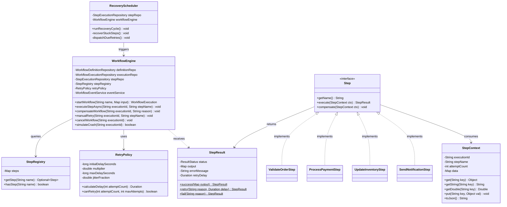
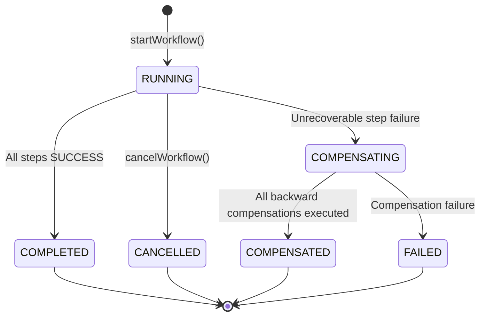
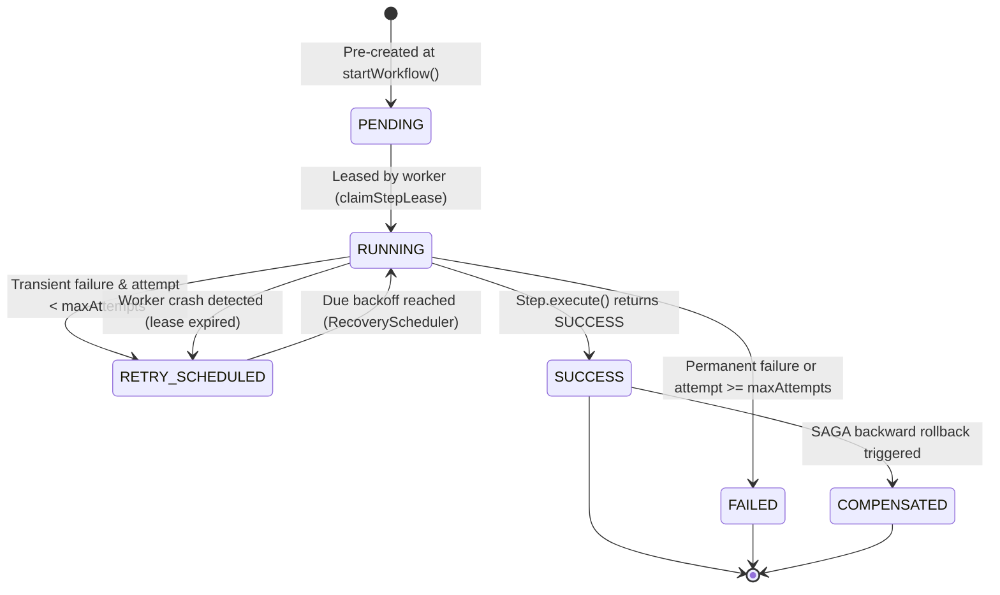

# Low-Level Design (LLD): Crash-Proof Workflow Engine (FlowLab)

## 1. Class Hierarchy & Core Abstractions



---

## 2. State Machines

### 2.1 Workflow Execution State Machine



### 2.2 Step Execution State Machine



---

## 3. Execution Sequence Diagram (Happy Path & Crash Recovery)

```mermaid
sequenceDiagram
    autonumber
    actor Client
    participant API as ExecutionController
    participant Engine as WorkflowEngine
    participant DB as PostgreSQL
    participant Worker as Async Worker Pool
    participant Sched as RecoveryScheduler
    participant Step as ProcessPaymentStep

    Client->>API: POST /api/v1/workflows/order-processing/executions
    API->>Engine: startWorkflow("order-processing", {amount: 149.99})
    Engine->>DB: INSERT workflow_execution (RUNNING, current_step=0)
    Engine->>DB: INSERT step_execution (0..3 as PENDING)
    Engine->>DB: INSERT workflow_event (WORKFLOW_STARTED)
    Engine-->>API: WorkflowExecution entity
    API-->>Client: 202 Accepted (Location: /api/v1/executions/{id})

    Engine->>Worker: executeStepAsync(executionId, "ValidateOrder")
    Worker->>DB: Atomic lease claim (PENDING -> RUNNING)
    Worker->>DB: UPDATE step_execution (SUCCESS, duration=800ms)

    Note over Worker, Engine: Advancing to ProcessPayment
    Engine->>Worker: executeStepAsync(executionId, "ProcessPayment")
    Worker->>DB: Atomic lease claim (lease_expires_at = now + 30s)
    Worker->>Step: execute(ctx)
    Step->>Step: Generate paymentId & call Payment Gateway

    alt Worker Host Dies (kill -9) before DB update
        Note over Worker: [CRASH] Host terminated abruptly!
        Note over Sched, DB: 30 seconds elapse; lease expires...
        Sched->>DB: Query: findStuckRunningSteps(status=RUNNING, lease_expires_at < now)
        DB-->>Sched: StepExecution("ProcessPayment")
        Sched->>DB: UPDATE step status = RETRY_SCHEDULED
        Sched->>Engine: executeStepAsync(executionId, "ProcessPayment")
        Engine->>Worker: Re-execute step
        Worker->>Step: execute(ctx)
        Step->>DB: Query idempotency_record
        DB-->>Step: Found existing paymentId ("PAY-A821F")
        Step-->>Worker: StepResult.success(cachedResult) (No double-charging!)
    end

    Worker->>DB: UPDATE step_execution (SUCCESS)
    Worker->>DB: UPDATE workflow_execution (current_step=2)
```

---

## 4. Concurrency Control & Database Locking

To guarantee correctness in a distributed cluster with $N$ worker instances:

### 4.1 Atomic Step Leases (Worker Mutual Exclusion)
Workers avoid race conditions through atomic SQL updates rather than uncoordinated memory locks:
```sql
UPDATE step_execution
SET status = 'RUNNING',
    lease_expires_at = :leaseExpiresAt,
    started_at = :now,
    attempt_count = attempt_count + 1,
    updated_at = :now
WHERE id = :stepId
  AND status IN ('PENDING', 'RETRY_SCHEDULED');
```
*If zero rows are updated, another worker has already acquired the lease or the step is already completed.*

### 4.2 Optimistic Concurrency Control on WorkflowExecution
The `WorkflowExecution` JPA entity uses Hibernate `@Version`:
```java
@Version
@Column(nullable = false)
private Integer version = 0;
```
If two workers complete different operations simultaneously, the second attempt will encounter an `OptimisticLockingFailureException`, preventing state divergence.

### 4.3 Database Unique Constraint Idempotency Guard
```sql
CONSTRAINT uq_execution_step UNIQUE (execution_id, step_name)
```
Guarantees that duplicate dispatch events cannot create duplicate step records for the same execution.

---

## 5. Exponential Backoff Algorithm

The `RetryPolicy` calculates delay using exponential backoff with full jitter to avoid the "thundering herd" problem:

$$\text{baseDelay} = \min\left(\text{maxDelay},\; \text{initialDelay} \times \text{multiplier}^{(\text{attempt} - 1)}\right)$$
$$\text{jitter} = \text{Uniform}(-\text{fraction} \times \text{baseDelay},\; +\text{fraction} \times \text{baseDelay})$$
$$\text{finalDelay} = \max\left(500\text{ ms},\; \text{baseDelay} + \text{jitter}\right)$$

Default configuration:
- $\text{initialDelay} = 2\text{ seconds}$
- $\text{multiplier} = 2.0$
- $\text{maxDelay} = 60\text{ seconds}$
- $\text{jitterFraction} = 0.20\; (\pm 20\%)$

---

## 6. SAGA Compensation Logic

When a step fails permanently (e.g., `UpdateInventoryStep` fails after exhausting all attempts or throwing an unrecoverable exception):
1. `WorkflowEngine.compensateWorkflow(executionId, reason)` is triggered.
2. The workflow execution status is marked `COMPENSATING`.
3. All steps that previously succeeded are queried ordered by `stepIndex DESC`.
4. For each successful step:
   - Look up the `Step` bean in `StepRegistry`.
   - Invoke `step.compensate(context)`.
   - Update step status to `COMPENSATED`.
   - Append `STEP_COMPENSATED` audit event.
5. Set `workflow_execution.status = COMPENSATED`.